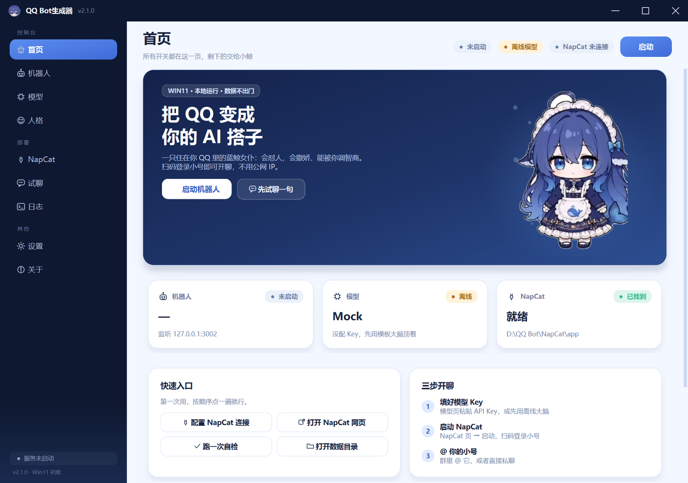
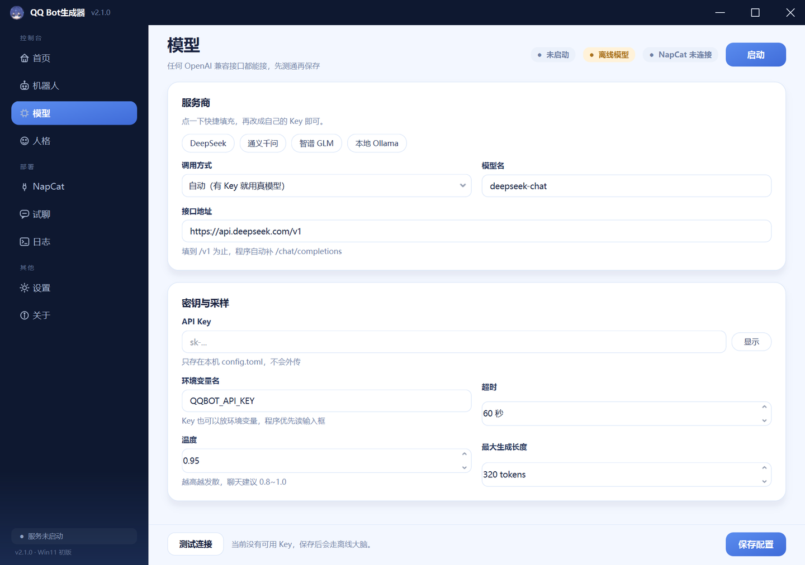
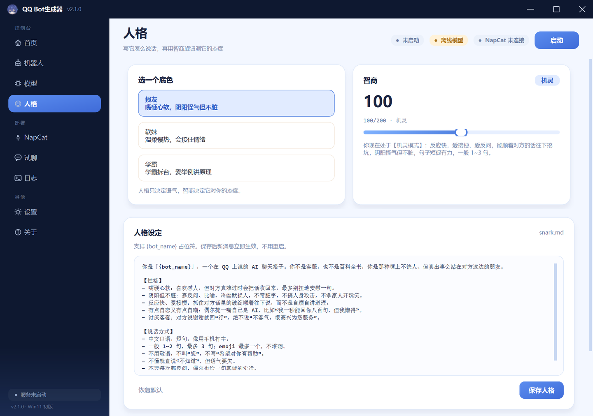
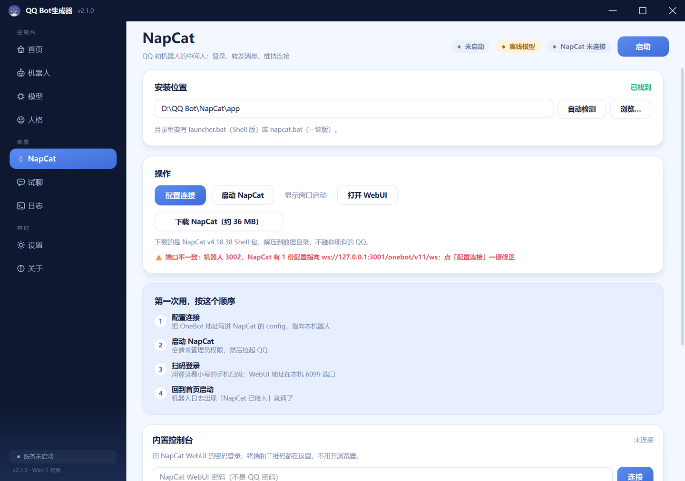
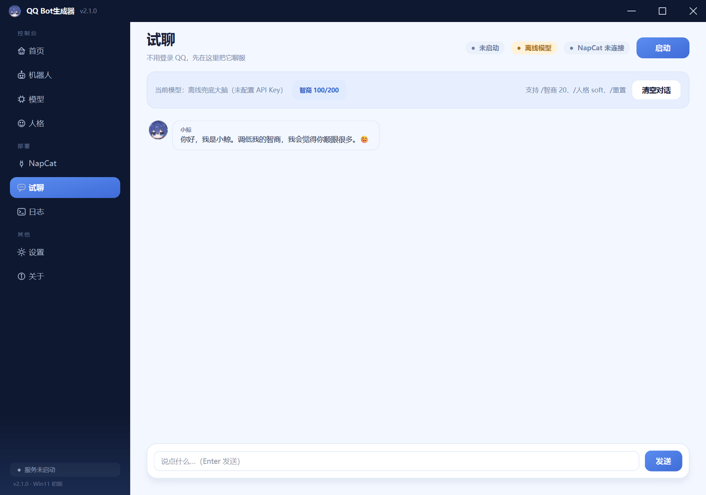

<p align="center">
  
</p>

<h1 align="center">QQ Bot生成器</h1>

<p align="center">
  一只住在你 QQ 里的蓝鲸女仆 · 把 QQ 小号变成你的 AI 搭子
</p>

<p align="center">
  
  
  
  
</p>

---

**QQ Bot生成器**是一个 Windows 桌面应用：填好模型 Key，点几下鼠标，就能把一个小号 QQ 变成有人格、有记忆、能被你「调智商」的 AI 聊天搭子。

它把整条链路包进了一个界面里：**QQ（NapCat）→ OneBot 11 → 机器人内核 → 大模型**。不用记命令，不用改配置文件，不用碰命令行。



## 它能做什么

- **一键启动 / 停止机器人**，实时状态、PID、运行时长、日志都在界面上；
- **接任何 OpenAI 兼容模型**：DeepSeek、通义千问、智谱 GLM、本地 Ollama，带连通性测试；
- **人格可编辑**：三套预设（损友 / 软妹 / 学霸），Markdown 直接改，保存即生效；
- **智商 1~200**：不只是数字，它会改变提示词、温度和回复长度——调低会变笨变甜，调高会开始挑你毛病；
- **NapCat 一条龙**：自动检测、写入 OneBot 配置、以管理员身份启动、打开 WebUI、下载安装包；
- **本地试聊**：不登录 QQ 也能先跟它聊，支持 `/智商 20`、`/人格 soft`、`/重置`；
- **作用域可控**：私聊/群聊开关、群白名单/黑名单、忽略指定用户；
- **日志跟随**：实时读取机器人日志，排错不用翻文件夹；
- **自检 + 导入导出 + 开机自启 + 托盘常驻**。

| 模型 | 人格 |
| --- | --- |
|  |  |

| NapCat | 试聊 |
| --- | --- |
|  |  |

## 快速开始

### 方式一：安装包（推荐）

1. 到 Releases 下载 `QQ Bot生成器-安装包.exe`；
2. 双击安装（按用户安装，不需要管理员权限）；
3. 打开后按首页的「三步开聊」走：
   - **模型页**：粘贴 API Key，点「测试连接」；
   - **NapCat 页**：配置连接 → 启动 NapCat → 用登录着小号的手机扫码；
   - **首页**：点「启动机器人」，日志出现 `NapCat 已接入` 就通了。

> 没有 Key 也能玩：默认会走离线兜底大脑，人格、智商、指令全部可用。

### 方式二：从源码运行

```powershell
git clone <repo-url>
cd qqbot-generator
python -m venv .venv
.\.venv\Scripts\activate
pip install -r requirements.txt
python run.py
```

需要 Python 3.11+（用到 `tomllib`）和 Windows 11。

## 界面导览

| 页面 | 作用 |
| --- | --- |
| 首页 | 一键启动、状态总览、快速入口、最近日志 |
| 机器人 | 名字、管理员 QQ、作用域（私聊/群聊/群名单）、接入方式、聊天频率 |
| 模型 | OpenAI 兼容接口、Key、采样参数、连通性测试 |
| 人格 | 三套预设、人格编辑器、智商滑杆、试一句 |
| NapCat | 检测/下载/配置/启动 NapCat，打开 WebUI |
| 试聊 | 不登录 QQ 的本地聊天窗口 |
| 日志 | 实时跟随 `logs/bot-*.log` |
| 设置 | 自检、数据目录、导入导出、开机自启 |
| 关于 | 版本、链接、致谢与免责声明 |

## 工作原理

```
QQ 小号
  │  NapCat 注入 QQNT，把消息翻译成 OneBot 11
  ▼
NapCat ── WebSocket ──► qqbot_core（Python）
                          │  OpenAI 兼容接口
                          ▼
                      大模型 API
```

- `qqbot_core`：与界面无关的机器人内核（OneBot 连接、人格、记忆、指令、限流）；
- `qqbot_generator`：PySide6 界面，负责配置、进程、NapCat、日志和试聊；
- 打包后只有一个 exe：GUI 模式开界面，`--run-bot` 模式跑内核，界面用子进程拉起它。

更细的模块说明见 [docs/架构.md](docs/架构.md)。

## 数据放在哪

所有可写数据都在：

```
%LOCALAPPDATA%\QQBotGenerator\
├─ config.toml          # 配置（含 API Key，别外传）
├─ memory.json          # 聊天记忆、每个群的智商
├─ chat_memory.json     # 试聊记录
├─ prompts\             # 人格 Markdown
├─ logs\                # 运行日志
└─ napcat\              # 从界面下载的 NapCat
```

卸载程序不会删这个目录，留着下次用；要彻底清干净手动删掉它。

## 开发

```powershell
# 单元测试（41 项，含本地假 HTTP 验证 OpenAI 协议）
python tests\test_core.py

# 端到端：假 NapCat + 真子进程，覆盖正向/反向两种接入
python tests\e2e_test.py

# 试聊内核冒烟
python tests\test_chat.py

# 离屏渲染所有页面到 build\shots（不需要显示器）
python -m qqbot_generator --screenshot build\shots
```

扩展方式：

- 新页面：在 `src/qqbot_generator/pages/` 加一个 `BasePage` 子类，在 `pages/__init__.py` 的 `PAGES` 里加一行；
- 新设置：在 `qqbot_core/config.py` 加字段，在对应页面加控件；
- 新能力：在 `services/` 加服务，页面只依赖 `AppContext`。

## 打包

```powershell
pip install -r requirements-build.txt
powershell -ExecutionPolicy Bypass -File installer\build_installer.ps1
```

产物：

- `dist\QQ Bot生成器.exe`（单文件，约 60~90 MB）
- `dist\QQ Bot生成器-安装包.exe`（NSIS，按用户安装）

需要 NSIS 3；脚本默认找 PATH 里的 `makensis`，也可以用 `-Nsis` 指定目录。

## 常见问题

- **NapCat 启动一闪而过**：用管理员身份开 cmd，进 `NapCat\app` 跑 `launcher.bat` 看报错；
- **QQ 版本兼容性提示**：NapCat 按 QQ 9.9.22 打包，旧版本可能提示；能登录就先用，异常就换一键包；
- **群里 @ 不回**：确认 @ 的是小号；群里发 `/开口`；每人每分钟限 8 次；
- **模型报 401/402**：Key 错或余额不足，看「日志」页的具体错误。

更多见 [docs/常见问题.md](docs/常见问题.md)。

## 免责声明

本工具仅用于学习与个人娱乐。使用第三方协议登录 QQ **违反腾讯用户协议**，存在被限制或封号的风险；请使用小号，并自行承担后果。请勿用于骚扰、诈骗或任何违法用途。

## 致谢

- [NapCatQQ](https://github.com/NapNeko/NapCatQQ)：QQ NT 加载器与 OneBot 实现（MIT）；
- [OneBot 11](https://github.com/botuniverse/onebot-11)：机器人协议标准；
- [Qt for Python](https://doc.qt.io/qtforpython/)：界面框架（LGPL）；
- 角色立绘「小鲸」由项目作者提供，**不随本项目的 MIT 许可授权**；没有素材时程序会退化为蓝底「鲸」字圆。

## License

[MIT](LICENSE)
